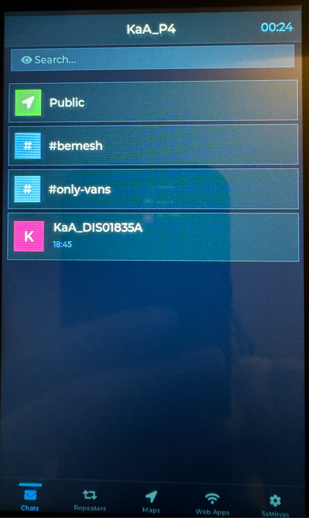
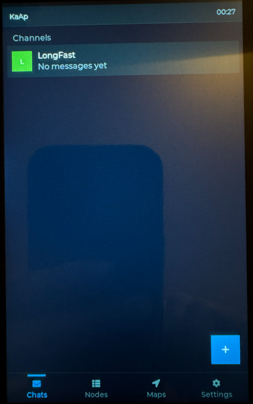

# CrowPanel DHE04005D

Standalone MeshCore and Meshtastic touchscreen firmware for the Elecrow
CrowPanel Advanced 5-inch ESP32-P4. A boot selector switches between the two
firmwares without reflashing.

<p align="center">
  
  
</p>

[Installation](docs/installation.md) | [Documentation](docs/README.md) |
[Screenshots](docs/screenshots.md) | [Contributing](CONTRIBUTING.md) |
[Release Checklist](docs/publishing.md)

## Install And Flash

Clone the repository and run `flash_all.py` to build the selector, MeshCore and
Meshtastic, then install the complete dual-boot firmware set:

```sh
git clone https://github.com/kgiannadakis/CrowPanel-DHE04005D.git
cd CrowPanel-DHE04005D
python flash_all.py <PORT>
```

Replace `<PORT>` with the CrowPanel serial port, for example `COM20` on Windows,
`/dev/ttyUSB0` on Linux, or `/dev/cu.usbserial` on macOS. The script validates
the partition layout and firmware images before flashing. Building and flashing
can take several minutes.

Requirements: Python 3.11, Git, PlatformIO, and esptool. A standard PlatformIO
installation normally includes the required PlatformIO CLI and esptool. Back up
important device data and close any serial monitor before starting.

For advanced options, pre-built binaries, updates, and troubleshooting, see the
full [installation guide](docs/installation.md).

## Firmware

| Project | Purpose | PlatformIO environment |
| --- | --- | --- |
| [MeshCore](meshcore/README.md) | Standalone mesh chat and repeater management | `dhe04005d-5inch-P4-meshcore` |
| [Meshtastic](meshtastic/README.md) | Custom CrowPanel chat, nodes, maps and settings UI | `dhe04005d-5inch-P4-meshtastic` |
| [Selector](selector/platformio.ini) | Touchscreen boot menu and remembered selection | `dhe04005d-5inch-P4-selector` |

MeshCore is based on [companion-v1.17.1](meshcore/docs/crowpanel_upstream.md).
Its current identifier is `1.17.1-p4-rc1`; this is a development build, not a
claim that every feature has passed hardware qualification.

### Meshtastic Features

- Standalone LoRa chat, custom channels, searchable contacts and node actions.
- Bidirectional MQTT with text-focused filtering and optional contact discovery.
- Persistent chat history, node records, identity and radio configuration.
- SD-backed offline maps, color emoji, EN/EL/DE input and copy/paste.
- Continuous SX1262 receive with boosted gain and idle-time health checks.

See the [Meshtastic guide](meshtastic/README.md) for board-specific behavior and
broker limitations. Its experimental CPU/RGB power-saving paths are reverted;
the backlight-only screen timeout remains.

### MeshCore Features

- Direct and public/private channel messaging, persistent history and delivery status.
- English, Greek and German keyboards, text selection, cut/copy/paste and swipe-to-reply.
- SD-backed color emoji and a 139-character message composer.
- Repeater discovery, remote management and remembered-password controls.
- Offline maps, clustered markers, optional labels and neighbour links for known locations.
- HTTP dashboard, Wi-Fi/NTP and automatic or manual translation.
- Persistent brightness/settings, battery status and screen-off CPU light sleep.
- Quiet serial RX diagnostics and persistent reboot evidence.

MeshCore's P4 Telegram and OTA APIs are compatibility stubs, not working services.
The dashboard has no authentication and belongs on a trusted LAN. Translation
sends message text to an external service; see the [security notes](meshcore/docs/crowpanel.md#feature-limits-and-security).

## Hardware

This port targets **DHE04005D**, not every CrowPanel model. It uses an ESP32-P4,
16 MB flash, 32 MB PSRAM, an 800x480 RGB display, GT911 touch, STC8 backlight/battery
controller, ESP32-C6 Wi-Fi coprocessor and SX1262 LoRa module.

See the [board guide](meshcore/variants/crowpanel_dhe04005d/README.md) for pin
assignments and the [installation guide](docs/installation.md#optional-rtc) for
the optional external RTC. Match the radio module and antenna to your band.


## Contributing And Support

Read [Contributing](CONTRIBUTING.md) before submitting a change. Report bugs with
the firmware/environment, build identifier, reproduction steps and sanitized
logs. Report vulnerabilities privately as described in [Security](SECURITY.md).
See [CHANGELOG.md](CHANGELOG.md) for changes and upgrade notes.

## Attribution And License

Built on [MeshCore](https://github.com/meshcore-dev/MeshCore),
[Meshtastic](https://meshtastic.org/), [LVGL](https://lvgl.io/), and Elecrow's
CrowPanel hardware. Offline maps use OpenStreetMap data; emoji assets derive
from Noto Color Emoji. Keep their attribution and licensing when redistributing.

The repository includes GPL-3.0 code; see [LICENSE](LICENSE). Bundled components
retain their own licenses, including [MeshCore's MIT license](meshcore/license.txt)
and vendored library notices. See [component notes](docs/README.md#third-party-code).
