# Screenshots

These images show the CrowPanel interfaces. They are reference screenshots,
not a guarantee that every image exactly matches the latest development build.

## MeshCore

| Chats | Repeaters | Maps |
| --- | --- | --- |
| 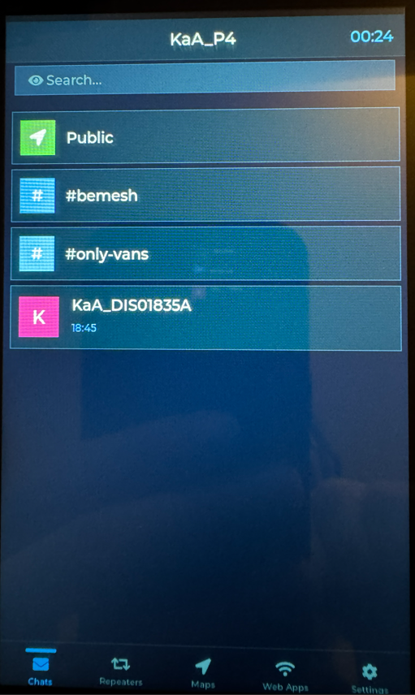 | 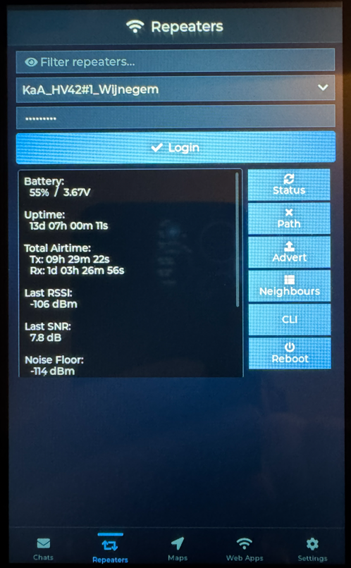 | 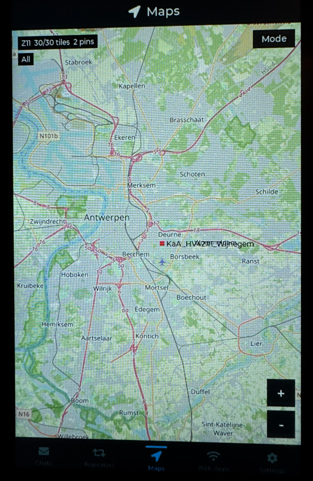 |

| Settings | Additional Settings | HTTP Dashboard |
| --- | --- | --- |
| 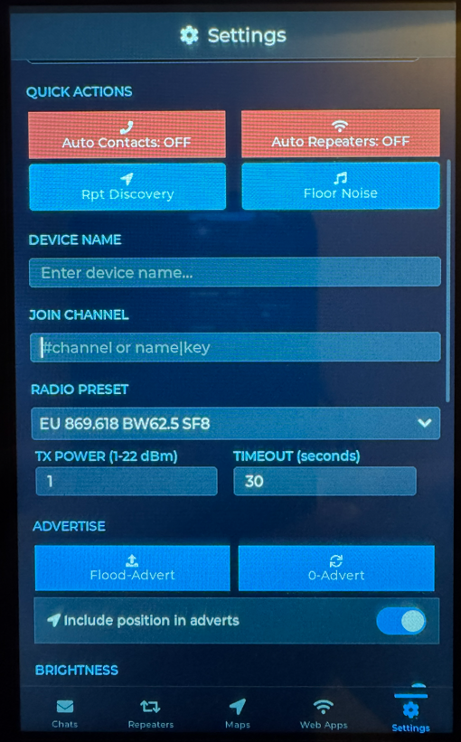 | 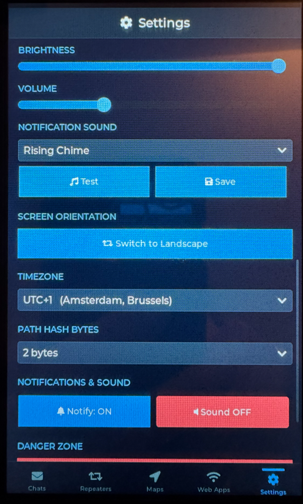 | 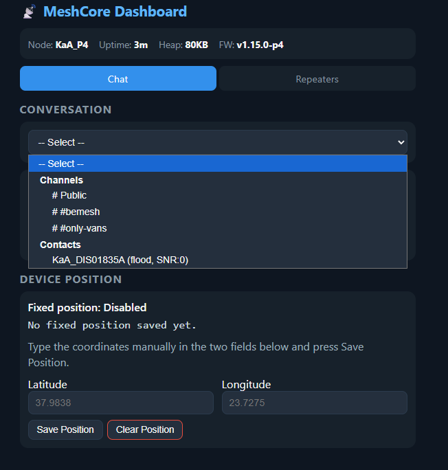 |

## Meshtastic

| Channels | Join Channel | MQTT |
| --- | --- | --- |
| 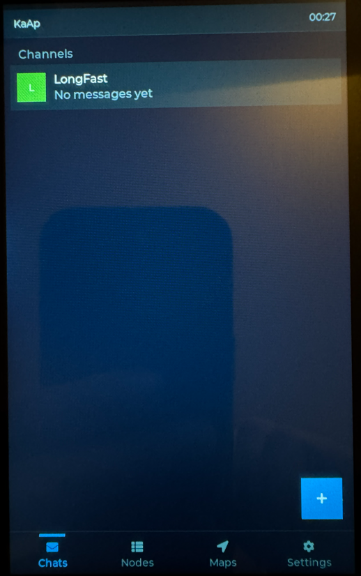 | 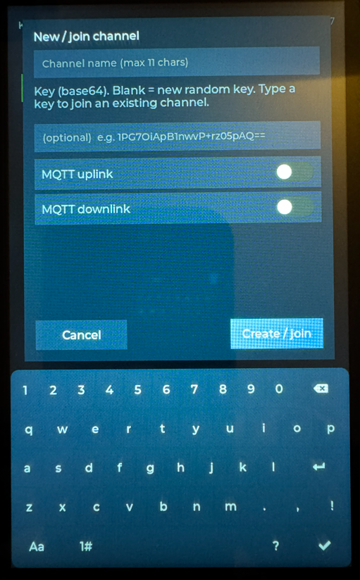 | 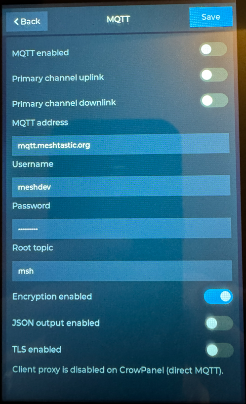 |

| Settings | Additional Settings |
| --- | --- |
| 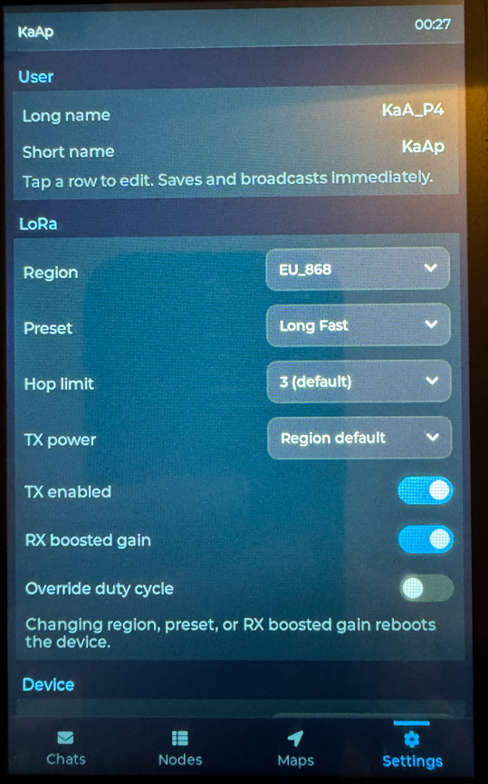 | 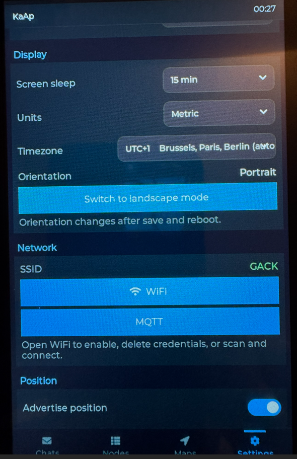 |

## Hardware

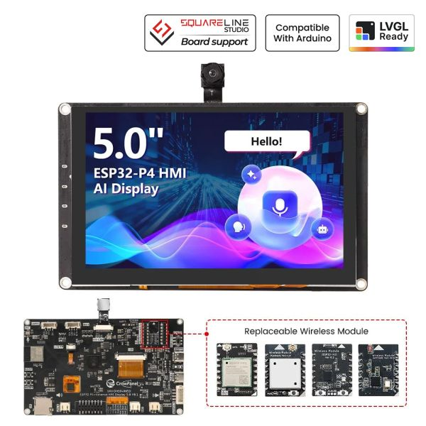

See [Installation](installation.md) and the
[board guide](../meshcore/variants/crowpanel_dhe04005d/README.md) before wiring or flashing.
